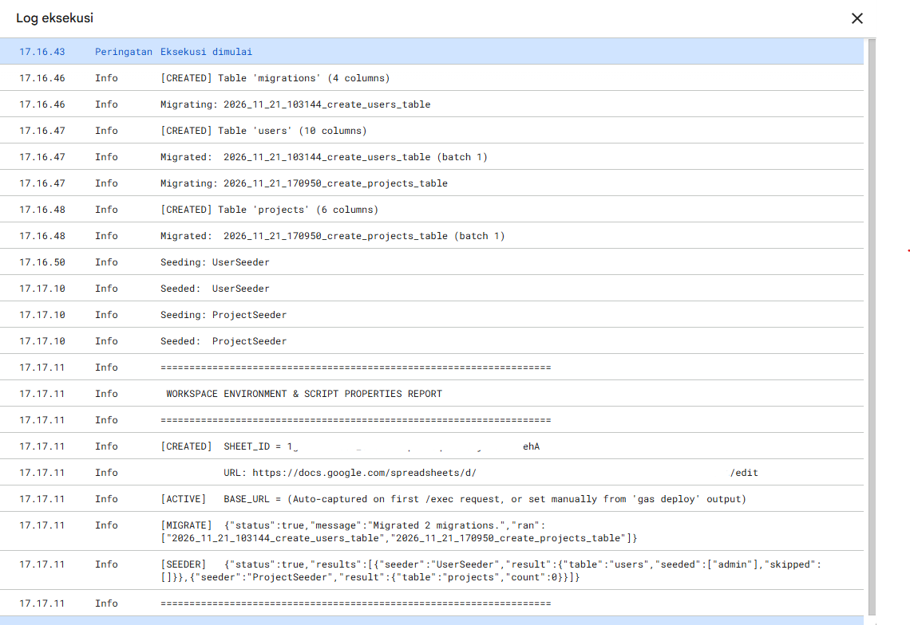
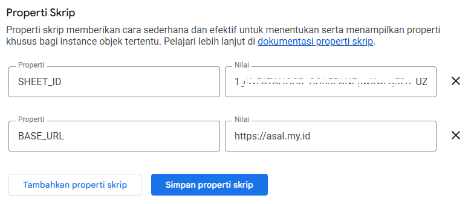

# Asal-GAS

**Laravel-inspired Hybrid Web & REST API MVC framework for Google Apps Script.**


[Quick Start](#quick-start-local-development) · [Web & API Modes](#hybrid-web--api-routing-modes) · [Blade-Lite Views](#blade-lite-view-engine) · [60-Second Workflow](#60-second-workflow) · [GAS Deployment](#deployment-to-google-apps-script) · [CLI Reference](#cli-reference-gas) · [API Convention](#api-request--payload-convention)

---

## Overview

**Asal-GAS** brings structured full-stack and API backend architecture to **Google Apps Script (GAS)** using Google Sheets as a relational-style datastore. Instead of maintaining monolithic `Code.gs` files, you get a local zero-quota Node.js emulator, a Blade-lite HTML templating engine, isolated GAS Web App SPA navigation, dual Web & API routing layers, stateless CSRF protection, schema migrations, database seeders, a unified `gas` CLI, and a hardened **Zero-HTTP-Bootstrap** security model.

### Key Features

- **Zero-Quota Local Emulator:** Build, migrate, seed, and test Web pages or JSON endpoints locally against `local/storage/db.json` with automatic port fallback and SSE live-reload (`APP_DEBUG=true`) without hitting Google Apps Script execution quotas.
- **Hybrid Web & API Architecture:** Separate `src/routes/web.js` and `src/routes/api.js` layers controlled by `APP_MODE` (`web` or `api`) and configurable `API_PREFIX` in `.env`. In `api` mode, web routes are completely disabled and `/` or `/index` resolve directly to your API index JSON response.
- **Blade-Lite View Engine:** Write pure HTML templates in `src/resources/views/**/*.gas.js` with `@extends`, `@section`, `@yield`, `@include`, `@if`, `@forelse`, `@csrf`, `{{ }}`, and `{!! !!}`—with instant local hot-reload and automatic compilation during `gas push` / `gas deploy`.
- **Isolated GAS Web App SPA Navigation:** Automatically intercepts internal links and form submissions (`POST`, `PUT`, `DELETE`) inside `HtmlService` iframes via `google.script.run` (`gasNavigate`) and `google.script.history`, preventing `X-Frame-Options` white screens and full iframe reloads while keeping user view layouts 100% pure HTML.
- **Stateless CSRF Protection (`APP_KEY`):** Built-in HMAC-SHA256 + stream-cipher encrypted CSRF tokens (`Csrf.js`), `@csrf` Blade directive, automatic verification middleware on mutating web routes (HTTP `419` on mismatch), and `gas key:generate` CLI management.
- **Unified `gas` CLI:** Scaffold modules, controllers (`--web`, `--api`, `--hybrid`), views, migrations, and seeders, inspect routes (`gas route:list`), generate `APP_KEY`, or manage `clasp` initialization, remote migrations, and Web App deployments from one tool.
- **Zero-HTTP-Bootstrap Security:** Workspace provisioning (`setupWorkspace`) is completely isolated from public `doGet`/`doPost` routes, guarded by `LockService` and owner-only execution (`access: MYSELF`).
- **V8 Load-Order Resilience & Request Caching:** Combines deterministic `filePushOrder`, lazy `Proxy` controller instantiation, per-request `ScriptProperties` caching (`CONFIG`), and derived HMAC key caching to eliminate `ReferenceError` issues and redundant RPC overhead.
- **Schema Migrations, Seeders & ORM:** Version-controlled table creation, column alterations, batch rollbacks, soft deletes (`deleted_at`) with `restore()` and `forceDelete()`, `bulkCreate()`, `find()`, multi-level relation hydration (`with`), indexing cache, and idempotent seeders.
- **Validation & Lifecycle Hooks:** Built-in `Validator.make(data, rules)` helper and `BaseController` lifecycle hooks (`beforeStore`, `afterStore`, `beforeUpdate`, `afterUpdate`, `beforeDestroy`, `afterDestroy`).
- **CORS-Safe Universal JSON Envelope:** Standardized `POST` payload (`action`, `session`, `id`, `data`) engineered to avoid HTTP `OPTIONS` preflight failures in GAS Web Apps.
- **Built-In Auth, TTL & Rate Limiting:** Salted PBKDF2 password hashing (`Hash.make`, `Hash.check`, `Hash.needsRehash`), session expiration (`session_expires_at`), `throttle` middleware, and automatic password field redaction.

---

## Project Structure

```text
├── gas                         # Unified CLI executable (Unix/macOS/Git Bash)
├── gas.cmd                     # Unified CLI wrapper (Windows CMD/PowerShell)
├── .env.example                # Environment template (APP_MODE, API_PREFIX, APP_DEBUG, APP_KEY, etc.)
├── .clasp.json.example         # Template clasp config with deterministic filePushOrder
├── .claspignore                # Excludes raw .gas.js views & local files from GAS push
├── package.json                # Dependencies and npm scripts
├── local/
│   ├── server.js               # Local HTTP dev server with auto port fallback & SSE hot-reload
│   ├── runtime/
│   │   ├── EnvLoader.js        # Loads local .env configuration into runtime
│   │   ├── GasLoader.js        # Loads src/ modules & views into local Node.js runtime
│   │   └── GasMocks.js         # Emulates SpreadsheetApp, PropertiesService, Utilities, etc.
│   └── storage/
│       └── .gitkeep            # Local JSON database directory (db.json is gitignored)
└── src/
    ├── appsscript.json         # GAS V8 manifest (executionApi: MYSELF, Web App settings)
    ├── main.js                 # HTTP entry points (doGet, doPost) & gasNavigate SPA bridge
    ├── app/
    │   └── Controllers/        # Web, API Resource (Proxy), and Hybrid controllers
    ├── config/
    │   └── config.js           # Cached ScriptProperties loader & CONFIG getters
    ├── core/
    │   ├── Controller_Base.js  # Base CRUD controller with hooks, soft delete & relations
    │   ├── Core_Router.js      # Dual Web/API route registration, CSRF/auth middleware & dispatching
    │   ├── Core_View.js        # Blade-lite template compiler & layout rendering engine
    │   ├── Csrf.js             # Stateless HMAC-SHA256 encrypted CSRF token generator & verifier
    │   ├── Database_Migration.js
    │   ├── Database_Seeder.js
    │   ├── crud.js             # Spreadsheet query, index cache, lock & mutation engine
    │   ├── database.js         # Spreadsheet connection & sheet resolver
    │   ├── env_sync.js         # EnvSync & owner-only WorkspaceSetup / setupWorkspace provisioner
    │   ├── foglobal.js         # Validator, sanitizer, HTML/JSON response & GAS SPA client runtime
    │   └── hash.js             # PBKDF2 password hashing & verification
    ├── database/
    │   ├── migrations/         # Timestamped schema migration files
    │   └── seeders/            # Database seeder definitions
    ├── middleware/
    │   └── middleware.js       # Session authentication & expiration guards
    ├── resources/
    │   └── views/              # Pure HTML + Blade-lite templates (*.gas.js)
    │       ├── layouts/
    │       │   └── app.gas.js
    │       └── home.gas.js
    ├── routes/
    │   ├── web.js              # Web routes (registerWebRoutes)
    │   └── api.js              # API routes (registerRoutes, auto-prefixed by API_PREFIX)
    └── tools/
        ├── CodeGenerator.js    # GAS Web Editor module/migration/controller generator
        └── DevTools.js         # Owner-only diagnostic & auth verification helpers
```

---

## Prerequisites

- **Node.js** `v18.0.0` or higher
- **Google Account** with Google Drive & Google Apps Script access
- **Google Apps Script API** enabled at [script.google.com/home/usersettings](https://script.google.com/home/usersettings)

---

## Quick Start (Local Development)

1. **Clone the repository and install dependencies:**
   ```bash
   git clone [https://github.com/aqshalzuhdi/asal-gas.git](https://github.com/aqshalzuhdi/asal-gas.git)
   cd asal-gas
   npm install
   ```

2. **Copy `.env.example` to `.env`, generate `APP_KEY`, and configure your runtime mode:**
   ```bash
   cp .env.example .env
   gas key:generate
   ```
   ```env
   APP_NAME="Asal-GAS"
   APP_MODE=web
   API_PREFIX=api
   APP_DEBUG=true
   APP_KEY="base64:..."
   ```

3. **Initialize the local database and run seeders:**
   ```bash
   gas migrate:fresh --seed
   ```

4. **Start the local development server:**
   ```bash
   npm run dev
   ```

5. **Open in browser or verify via curl:**
   ```bash
   curl "http://localhost:3000"
   curl "http://localhost:3000/api"
   ```

---

## Hybrid Web & API Routing Modes

Asal-GAS splits routing into two clean files:
- **`src/routes/web.js`** (`registerWebRoutes()`) — serves HTML views and CSRF-protected browser forms without an API prefix.
- **`src/routes/api.js`** (`registerRoutes()`) — automatically prefixed with `API_PREFIX` from `.env` (defaults to `api`).

Behavior switches automatically based on `APP_MODE` in `.env` (synced to GAS Script Properties on `gas push` / `gas deploy`):

| `APP_MODE` | `src/routes/web.js` | `src/routes/api.js` (e.g., `API_PREFIX=api`) |
| :--- | :--- | :--- |
| **`web`** | All web routes (`/`, `/index`, `/users/create`, etc.) are active and render HTML views. | All API routes (`/api`, `/api/login`, `/api/users`, etc.) are active and return JSON. |
| **`api`** | Completely disabled/skipped. `View.make()` also forces JSON responses. | All API routes remain active under `/${API_PREFIX}`. Accessing `/`, `/index`, `?route=`, or `?route=index` automatically resolves to the API index route (`""` or `"index"` in `api.js`) as JSON. |

*(To disable the API prefix completely, set `API_PREFIX=none` in `.env`.)*

---

## Blade-Lite View Engine

Views live in `src/resources/views/` using the `.gas.js` extension and contain **100% pure HTML + Blade-lite directives** without manual `View.register()` calls or framework-coupled scripts. Dot notation maps directly to directory paths (`view("users.create")` resolves `src/resources/views/users/create.gas.js`).

### Layout Example (`src/resources/views/layouts/app.gas.js`)
```html
<!DOCTYPE html>
<html lang="id">
<head>
    <meta charset="utf-8">
    <meta name="viewport" content="width=device-width, initial-scale=1">
    <title>@yield('title', appName)</title>
    @stack('styles')
</head>
<body>
    <nav>
        <a href="{{ url('/') }}">Home</a>
    </nav>
    <main>
        @yield('content')
    </main>
    @stack('scripts')
</body>
</html>
```

### Page & Form Example (`src/resources/views/home.gas.js`)
```html
@extends('layouts.app')

@section('title', 'Home - ' + appName)

@section('content')
    <h1>Welcome, {{ user.name }}</h1>
    <p>API Endpoint: <code>{{ apiUrl('/users') }}</code></p>

    <form method="POST" action="{{ url('/users') }}">
        @csrf
        <input type="text" name="name" required>
        <button type="submit">Save</button>
    </form>

    <ul>
        @forelse (items as item)
            <li>{{ loop.iteration }}. {{ item.name }}</li>
        @empty
            <li>No records found.</li>
        @endforelse
    </ul>
@endsection
```

### Supported Directives & Helpers
- **Layouts & Partials:** `@extends('layouts.app')`, `@section('name') ... @endsection`, `@yield('name', 'default')`, `@include('partials.alert')`, `@includeIf(...)`, `@push('scripts') ... @endpush`, `@stack('scripts')`
- **Control Flow & Loops:** `@if`, `@elseif`, `@else`, `@endif`, `@unless`, `@isset`, `@empty`, `@foreach (items as key => item)`, `@forelse (items as item) ... @empty ... @endforelse`, `@for` (with `loop.index`, `loop.iteration`, `loop.first`, `loop.last`, `loop.count`)
- **Security, Output & Routing:** `@csrf`, `csrfToken()`, `csrfField()`, `{{ escaped }}`, `{!! rawHtml !!}`, `{{-- comment --}}`, `url('/path')`, `apiUrl('/users')`, `route('users.edit', { id: 1 })`, `json(data)`
- **GAS Compilation & Runtime Isolation:** During local development (`APP_DEBUG=true`), `.gas.js` views hot-reload automatically via SSE. When running `gas push` or `gas deploy`, `compileViews()` bundles all templates into `src/core/Core_Views_Compiled.js`. On Google Apps Script Web Apps, `createHtmlOutputSafe()` injects an isolated client runtime (`google.script.run` + `google.script.history`) automatically so your views stay completely framework-agnostic and safe from `gas framework:update`.

---

## 60-Second Workflow

Create a complete CRUD resource from scratch in four steps:

1. **Scaffold Migration, Seeder, and Controller:**
   ```bash
   gas make:module Project
   ```

2. **Define columns in the generated migration (`src/database/migrations/..._CreateProjectsTable.js`):**
   ```javascript
   Schema.create("projects", function (table) {
       table.id();
       table.string("name");
       table.string("status");
       table.timestamps();
       table.softDeletes();
   });
   ```

3. **Register the resource route in `src/routes/api.js`:**
   ```javascript
   Route.resource("projects", "ProjectController");
   ```

4. **Migrate locally, test, and deploy to Google Apps Script:**
   ```bash
   gas migrate
   gas deploy "Add projects module"
   ```

---

## Deployment to Google Apps Script

### 1. Authenticate & Create Remote Project
```bash
gas login
gas init "My GAS Backend"
```
*(To connect an existing GAS project instead, run `gas init --id <SCRIPT_ID>`.)*

### 2. Deploy as Web App
```bash
gas deploy "v2.1.0"
```
On the first push/deploy, if `APP_KEY` is not yet set, the CLI will prompt you to generate and save one automatically. `gas deploy` compiles views, pushes `src/` to Google Apps Script, publishes a versioned Web App deployment, syncs `.env` keys (`APP_MODE`, `API_PREFIX`, `APP_DEBUG`, `APP_KEY`) to Script Properties, and outputs your production URL (`https://script.google.com/macros/s/<DEPLOYMENT_ID>/exec`).

### 3. One-Time Workspace Provisioning (Owner-Only)
Because public HTTP routes are locked against unauthenticated bootstrapping:

1. Open the GAS Web Editor:
   ```bash
   gas open
   ```
2. Select **`setupWorkspace`** from the function dropdown in the top toolbar and click **Run**.
3. Approve the Google OAuth consent screen (**Review permissions → Advanced → Allow**).
   - `setupWorkspace()` creates a dedicated Google Spreadsheet, stores `SHEET_ID` in **Script Properties**, executes all pending migrations, and runs initial seeders.
4. *(Optional)* Copy the `Web App URL` from your terminal and save it as `BASE_URL` in **Project Settings → Script Properties**.

*(Alternatively, configure desktop OAuth credentials once via `gas creds` to run remote migrations and seeders directly from your terminal using `gas deploy --migrate --seed` or `gas migrate:remote --seed`.)*

**Execution Log Output (`setupWorkspace`):**



**Configured Script Properties (`SHEET_ID` & `BASE_URL`):**



### 4. Subsequent Updates
For future releases, run:
```bash
gas deploy "v2.1.1"
```
`gas deploy` automatically reuses your saved `deploymentId` so your production `/exec` URL remains constant.

---

## CLI Reference (`gas`)

> **Windows users:** Run `gas` directly via `gas.cmd` in Command Prompt/PowerShell, or execute `npm link` once to register `gas` globally.

### Google Apps Script & Deployment

| Command | Description |
| :--- | :--- |
| `gas init [Title] [--id <ScriptId>] [-f]` | Create a new standalone GAS project or link an existing `scriptId` in `.clasp.json`. |
| `gas login` | Authenticate your Google account via `clasp`. |
| `gas creds [-f\|--force]` | Setup `creds.json` & authenticate `clasp` for remote CLI execution (`clasp run`). |
| `gas key:generate [-f\|--force]` | Generate `APP_KEY` in `.env` & `.clasp.json`, and sync it to GAS Script Properties. |
| `gas push [-f] [--seed] [--setup]` | Compile views, prompt `APP_KEY` (first run), push `src/` to GAS, and sync via `setupWorkspace`. |
| `gas pull` | Pull remote files from Google Apps Script into `src/`. |
| `gas status` | Check file sync status between local `src/` and remote GAS. |
| `gas open` | Open the active project in the Google Apps Script Web Editor. |
| `gas deploy [Description] [--migrate] [--seed] [--setup]` | Compile views, prompt `APP_KEY` (first run), push latest code, and create or update the production Web App deployment. |
| `gas framework:update [--dry-run] [--remote <name>]` | Pull updates for core framework, local runtime, and CLI files (`gas`, `src/core`, `src/middleware`, `src/config/config.js`, `local/runtime`, `local/server.js`) without overwriting project files. |

### Code Generators & Views

| Command | Description |
| :--- | :--- |
| `gas make:module <Entity> [--api\|--hybrid\|--web]` | Generate a Migration, Seeder, and Controller in one command (defaults to `--api`). |
| `gas make:migration <Name>` | Create a timestamped migration in `src/database/migrations/`. |
| `gas make:controller <Name> [--web\|--api\|--hybrid]` | Create a Web (`--web`, default), API Resource (`--api`), or Hybrid (`--hybrid`) controller. |
| `gas make:seeder <Name>` | Create a seeder file in `src/database/seeders/`. |
| `gas make:view <Name>` | Create a Blade-lite `.gas.js` template in `src/resources/views/`. |
| `gas view:compile` | Compile all `src/resources/views/**/*.gas.js` templates into `src/core/Core_Views_Compiled.js`. |

### Local & Remote Database, Routing & Diagnostics

| Command | Description |
| :--- | :--- |
| `gas route:list [Filter] [--method <HTTP>]` | Display all registered Web & API routes, HTTP methods, actions, middlewares, and sheets. |
| `gas migrate [--seed] [--no-count]` | Run all pending migrations against `local/storage/db.json` (and optionally seed). |
| `gas migrate:fresh [--seed] [--no-count]` | Reset `local/storage/db.json`, re-run all migrations, and optionally seed. |
| `gas migrate:rollback` | Roll back the last local migration batch. |
| `gas migrate:status` | List all migrations and their local execution status. |
| `gas migrate:remote [--seed] [--no-count]` | Run all pending migrations (and optionally seed) on remote Google Sheets. |
| `gas migrate:remote:rollback` | Roll back the last migration batch on remote Google Sheets. |
| `gas migrate:remote:refresh [--seed] [--no-count]` | Roll back and re-run remote migrations (and optionally seed) on Google Sheets. |
| `gas db:seed [Seeder] [--remote] [--no-count]` | Execute `DatabaseSeeder` (or a specific seeder) locally or on remote Google Sheets. |
| `gas db:seed:remote [Seeder] [--no-count]` | Execute `DatabaseSeeder` (or a specific seeder) directly on remote Google Sheets. |
| `gas db:reindex` | Rebuild local schema metadata and row lookup indexes. |

---

### Updating Framework in an Existing Project

To pull framework, local runtime, and CLI improvements from `asal-gas` into an existing project without overwriting custom routes (`src/routes/web.js`, `src/routes/api.js`), views (`src/resources/views`), controllers, migrations, seeders, or local credentials:

```bash
gas framework:update --dry-run
gas framework:update
```

---

## API Request & Payload Convention

Google Apps Script Web Apps dispatch routes via the `route` query parameter (`?route=<path>`), while the local Node.js server supports both clean paths (`/api/users`) and `?route=api/users`. All routes in `src/routes/api.js` are automatically prefixed with `API_PREFIX` (default: `api`). Because GAS does not support HTTP `OPTIONS` preflight requests, all mutations use a standardized JSON envelope over `POST`.

### 1. API Health Check (`GET`)
```http
GET https://script.google.com/macros/s/<DEPLOYMENT_ID>/exec?route=api
```

### 2. Authentication (`POST ?route=api/login`)
```json
{
    "username": "admin",
    "password": "password123"
}
```

### 3. Query & Pagination (`GET ?route=api/<resource>`)
```http
GET https://script.google.com/macros/s/<DEPLOYMENT_ID>/exec?route=api/users&session={{session}}&page=1&per_page=15&sort=-id
```

### 4. Universal Mutation Envelope (`POST ?route=api/<resource>`)

**Create Record (`action: "create"`):**
```json
{
    "action": "create",
    "session": "{{session}}",
    "data": {
        "name": "Acme Corporation",
        "email": "contact@example.com"
    }
}
```

**Update Record (`action: "update"`):**
```json
{
    "action": "update",
    "session": "{{session}}",
    "data": {
        "id": 1,
        "name": "Acme Global Ltd."
    }
}
```

**Soft Delete Record (`action: "delete"`):**
```json
{
    "action": "delete",
    "session": "{{session}}",
    "id": 1
}
```

**Restore Soft-Deleted Record (`action: "restore"`):**
```json
{
    "action": "restore",
    "session": "{{session}}",
    "id": 1
}
```

**Permanently Delete Record (`action: "force-delete"`):**
```json
{
    "action": "force-delete",
    "session": "{{session}}",
    "id": 1
}
```

---

## Architecture & Security Design

### 1. Zero-HTTP-Bootstrap
`src/main.js` only dispatches registered application routes (`doGet`, `doPost`, and `gasNavigate`). Workspace provisioning (`WorkspaceSetup.init()` in `src/core/env_sync.js`) cannot be triggered by anonymous HTTP requests, eliminating first-claim hijacking or unauthorized spreadsheet creation on public deployments.

### 2. Stateless CSRF Protection (`APP_KEY`)
All mutating web routes (`POST`, `PUT`, `PATCH`, `DELETE`) registered in `src/routes/web.js` automatically prepend the `csrf` middleware (pass `{ withoutCsrf: true }` in route options to opt out). `Csrf.js` signs and encrypts expiring tokens using keys derived from `APP_KEY` via HMAC-SHA256, validating `_token`, `csrf_token`, or `X-CSRF-TOKEN` / `X-XSRF-TOKEN` headers without storing server-side session state.

### 3. Isolated GAS Iframe SPA Runtime
Google Apps Script Web Apps render inside nested sandboxed iframes that block standard cross-frame reloads (`X-Frame-Options`). `createHtmlOutputSafe()` in `src/core/foglobal.js` configures `XFrameOptionsMode.ALLOWALL` and injects a self-contained client runtime that intercepts internal navigation and form submissions via `google.script.run.gasNavigate(...)` and `google.script.history`, keeping user Blade views in `src/resources/views/` completely clean.

### 4. GAS V8 Load-Order Safety
In Google Apps Script's V8 runtime, top-level code executes sequentially by file order. Controllers wrap `BaseController.init(...)` inside an ES6 `Proxy` so initialization is deferred until the first incoming request—guaranteeing all `src/core/` dependencies are loaded first:

```javascript
var ProjectController = (function () {
    var _instance;
    return new Proxy({}, {
        get: function (_, prop) {
            if (!_instance) {
                _instance = BaseController.init({
                    sheet: "projects",
                    with: []
                });
            }
            var val = _instance[prop];
            return typeof val === "function" ? val.bind(_instance) : val;
        }
    });
})();
```

### 5. Sensitive & Generated File Isolation
`.env`, `.clasp.json`, `.clasprc.json`, `creds.json`, `local/storage/*.json`, and `src/core/Core_Views_Compiled.js` are ignored via `.gitignore` so personal credentials, local test records, and compiled view artifacts stay out of version control.

---

## License

Released under the [MIT License](LICENSE).
